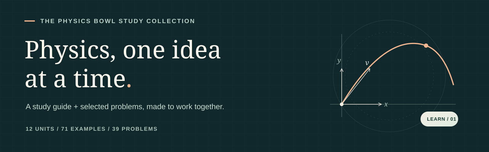
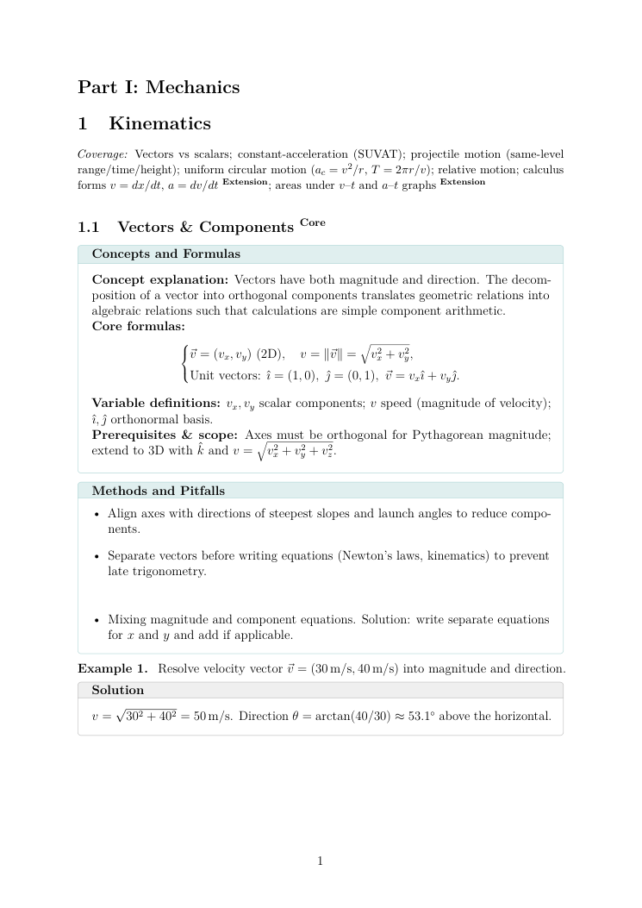
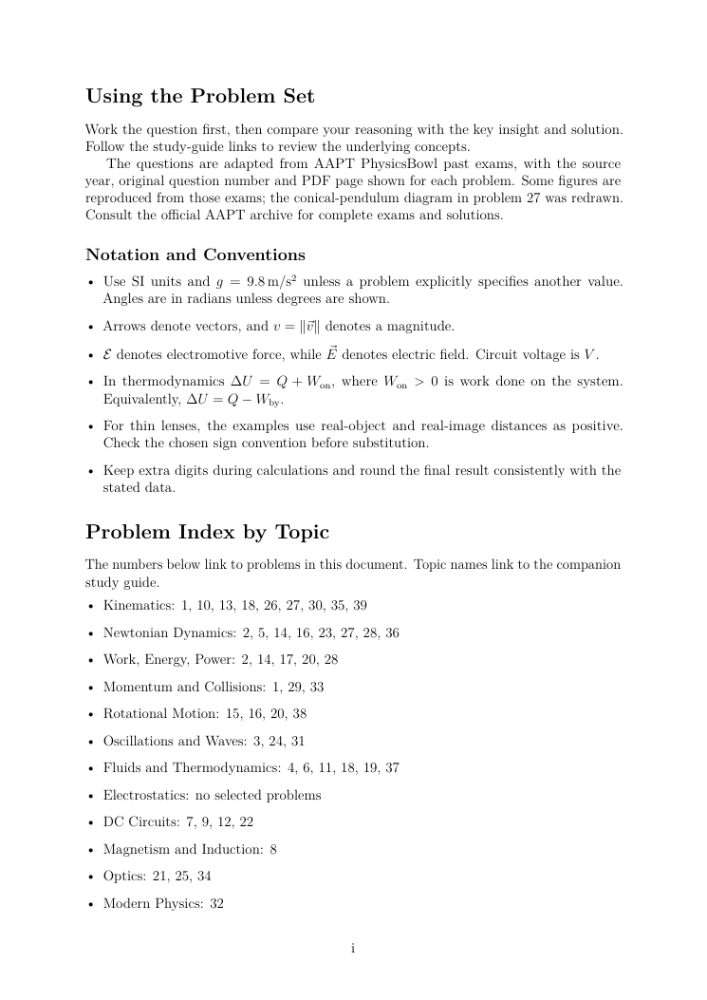
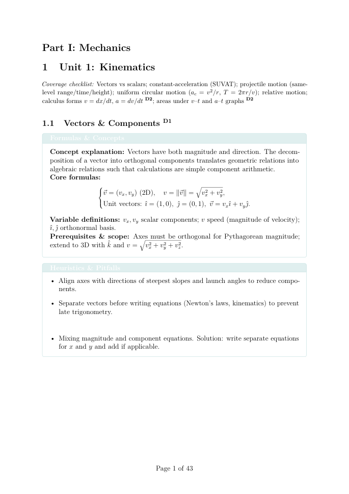

<p align="center">
  An independent study guide and problem set by <strong>Ray Zhou</strong>.
</p>
<p align="center">
  <a href="https://qiuxue-yee.github.io/Physics-Bowl-CheatSheets-prepmaterial/">Explore the collection</a>
  &nbsp;·&nbsp;
  <a href="docs/CheatSheets.pdf">Study guide PDF</a>
  &nbsp;·&nbsp;
  <a href="docs/Physics_Bowl_Initial_Version.pdf">Problem set PDF</a>
  &nbsp;·&nbsp;
  <a href="#中文说明">中文说明</a>
</p>

---

## A better way back to the idea

When a physics problem goes wrong, knowing the right formula is only part of
the answer. Which conditions made it useful? What did the diagram leave out?
And where can you go to revisit that idea?

This collection connects **concepts, conditions, worked examples, and practice**
in two companion books. Start with a topic, try a problem, and follow the links
back to the reasoning you want to revisit.

## The collection

| **01 / Study guide** | **02 / Selected problems** |
| :--- | :--- |
| Concepts, formulas, methods and worked examples across **12 units**. | **39 questions** with a topic index, key insights, worked solutions and source citations. |
| [Open the study guide →](docs/CheatSheets.pdf) | [Open the problem set →](docs/Physics_Bowl_Initial_Version.pdf) |
|  |  |

The guide has four parts and 71 worked examples. Its **Core** and
**Extension** labels are reading cues, not official PhysicsBowl division
classifications. Download the two PDFs into the same folder for their
cross-document links; support for these links varies by PDF viewer.

## From notes to a connected resource

This revision began with a practical problem: useful material was spread
across long source files, some figures and explanations did not match, and a
reader had no direct path from a question back to its concept.

1. **Organize.** Split the guide into 12 maintainable units and the problem set
   into four groups; keep the original problem numbers and PDF paths.
2. **Connect.** Add a topic index, reading route, and links between the two
   books.
3. **Check.** Trace the 39 selected questions to AAPT exams, compare their
   answers with the official keys, and correct mismatched figures and
   derivations.
4. **Keep improving.** Build both PDFs from source and record corrections and
   open questions in [REVIEW.md](REVIEW.md).

| Earlier guide | Revised guide |
| :--- | :--- |
|  |  |

The project does not claim unmeasured readership or learning outcomes. The
review is documented, but it is not a substitute for an independent
subject-matter review. Found a mistake? [Open an issue](https://github.com/qiuxue-yee/Physics-Bowl-CheatSheets-prepmaterial/issues).

## For contributors

| Path | What it contains |
| :--- | :--- |
| `guides/physics/CheatSheets.tex` | Study-guide entry point |
| `guides/physics/units/` | One source file per unit |
| `Physics_Bowl_Initial_Version.tex` and `problems/` | Problem-set entry point and question groups |
| `tex/` and `data/` | Shared styles, conventions, topic map and source records |
| `docs/` | Download page, previews and the two PDFs |
| `scripts/` and `tests/` | Build, integrity, calculation and PDF checks |

Install Python 3 and TeX Live with pdfLaTeX, TikZ, tcolorbox and siunitx. From
the repository root:

```sh
python -m pip install PyMuPDF
python -m unittest discover -s tests -v
python scripts/build.py --write-docs
python scripts/inspect_pdfs.py
```

The build alternates LaTeX passes to resolve references between books. The PDF
inspection checks page bounds, companion destinations and source links.
When editing the topic map or sources, update the JSON files in `data/` and
run `python scripts/generate_crossrefs.py` before building. GitHub Actions
builds the PDFs and publishes the `docs/` folder on pushes to `main`.

## Sources & attribution

This is an independent, non-official guide and is not endorsed by AAPT. The
selected question statements and some figures originate in AAPT materials;
each problem cites a source paper. The [AAPT exam archive](https://www.aapt.org/Programs/PhysicsBowl/printexams.cfm)
provides complete exams and official solutions.

Original explanatory material is shared under [CC BY-NC-SA 4.0](https://creativecommons.org/licenses/by-nc-sa/4.0/).
That license does not grant rights to AAPT's questions or figures.

---

## 中文说明

这是 Ray Zhou 整理的独立 PhysicsBowl 学习资料，包括一本知识手册和一本
精选习题册。项目希望把**概念、适用条件、解题思路和练习**连接起来：
先理解知识点，再通过习题发现问题，并回到对应内容复习。

- [知识手册](docs/CheatSheets.pdf)：四个部分、12 个单元、71 道例题。
- [精选习题](docs/Physics_Bowl_Initial_Version.pdf)：39 道题，附主题索引、解答和原题来源。
- [校对记录](REVIEW.md)：记录本次修正、依据及仍需注意的事项。

本项目与 AAPT 无官方隶属关系；AAPT 题目和图片的来源已逐题注明。
