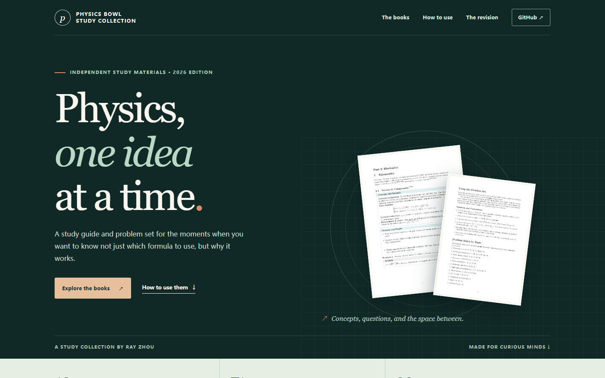

# Physics Bowl Study Collection

An independent study guide and problem set by Ray Zhou, connecting physics
concepts with worked examples and practice questions.

**[Explore the collection →](https://qiuxue-yee.github.io/Physics-Bowl-CheatSheets-prepmaterial/)**

## The collection

| Study guide | Selected problems |
| :--- | :--- |
| Concepts, formulas, methods, and 71 worked examples across 12 units. | 39 questions with worked solutions, topic references, and source citations. |
| [Read the guide →](https://qiuxue-yee.github.io/Physics-Bowl-CheatSheets-prepmaterial/CheatSheets.pdf) | [Read the problem set →](https://qiuxue-yee.github.io/Physics-Bowl-CheatSheets-prepmaterial/Physics_Bowl_Initial_Version.pdf) |
|  |  |

[Download both books →](https://qiuxue-yee.github.io/Physics-Bowl-CheatSheets-prepmaterial/PhysicsBowl_Study_Collection.zip)

The online editions link between related topics and questions. For the offline
editions in the ZIP, extract both PDFs into the same folder and use a reader
that supports links to local files. The guide's **Core** and **Extension** labels
are reading cues, not official PhysicsBowl division classifications.

## Sources and corrections

This is an independent resource and is not affiliated with or endorsed by AAPT.
Selected questions and some figures originate in AAPT materials; each problem
cites its source. The [AAPT exam archive](https://www.aapt.org/Programs/PhysicsBowl/printexams.cfm)
provides complete exams and official solutions.

The [review notes](REVIEW.md) document checks, corrections, and remaining
questions. If you find a mistake, please [open an issue](https://github.com/qiuxue-yee/Physics-Bowl-CheatSheets-prepmaterial/issues).

Original explanatory material is shared under [CC BY-NC-SA 4.0](LICENSE).
This license does not grant rights to AAPT's questions or figures.

## 中文说明

这是一套独立的 PhysicsBowl 学习资料，包括一本知识手册和一本精选习题册。
手册按主题整理概念、公式和例题；习题册收录 39 道题，并附解答和原题来源。

[打开学习资料网站](https://qiuxue-yee.github.io/Physics-Bowl-CheatSheets-prepmaterial/) ·
[查看校对记录](REVIEW.md)

本项目与 AAPT 无官方隶属关系。构建及维护方法见 [Developer notes](docs/DEVELOPMENT.md)。
